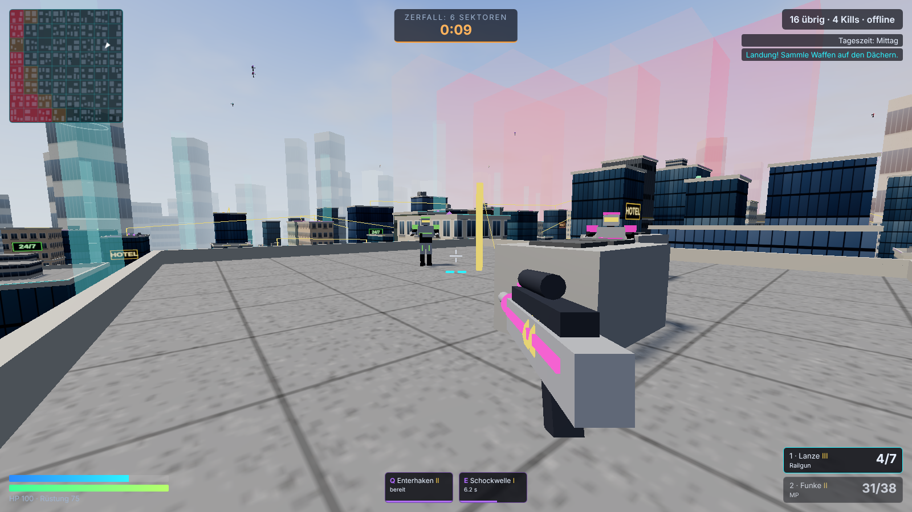
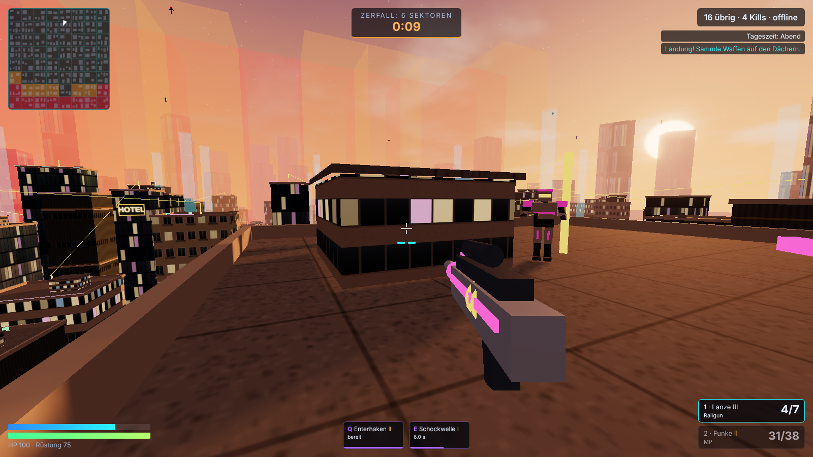
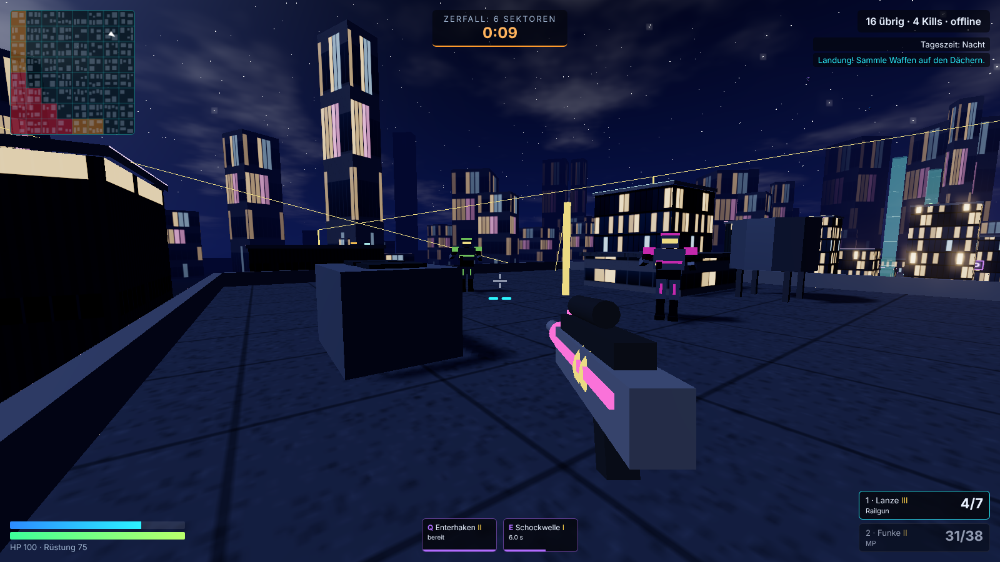

# Zerfallzone

| Mittag | Abend | Nacht |
|---|---|---|
|  |  |  |

Ein eigener, vertikaler Arena-Battle-Royale: Solo, Duos oder Trios in einer prozedural
erzeugten Neon-Stadt, die dynamisch Sektor für Sektor zerfällt. Spielbar **offline gegen
bis zu 40 Bots** oder **online mit Freunden**. PC-App und Browser spielen zusammen.

## Spielen

| Wie | Was du brauchst | Start |
|---|---|---|
| **PC-App** (Windows/Mac/Linux) | Die heruntergeladene Datei, siehe unten | `Zerfallzone Setup.exe` installieren oder die portable `.exe` starten |
| **Browser** | Node.js 20+ | `npm install && npm start`, dann http://localhost:7777 |
| **Aus dem Quellcode als App** | Node.js 20+ | `npm install && npm run app` |
| **Eigener Online-Server** (VPS) | Docker | `docker build -t zerfallzone . && docker run -p 7777:7777 zerfallzone` |

### PC-App herunterladen

GitHub baut die App automatisch, sobald sich etwas in `zerfallzone/` ändert
(Workflow `.github/workflows/zerfallzone.yml`):

1. Im Repository auf **Actions → „Zerfallzone bauen“** gehen und den neuesten Lauf öffnen.
2. Unten unter **Artifacts** liegen `Zerfallzone-Windows` (Installer und portable `.exe`), `Zerfallzone-macOS` (`.dmg`) und `Zerfallzone-Linux` (`.AppImage`).

Die App ist nicht signiert. Windows zeigt deshalb beim ersten Start „Der Computer wurde
durch Windows geschützt“: auf **Weitere Informationen → Trotzdem ausführen** klicken.
Auf dem Mac: Rechtsklick → Öffnen. Für den Verkauf auf Steam oder itch.io lohnt sich
später ein Code-Signing-Zertifikat.

Selbst bauen: `npm run dist:win`, `dist:mac` oder `dist:linux`. Ein Windows-Build
braucht Windows oder Wine, ein Mac-Build einen Mac.

### Mit Freunden spielen (Crossplay PC ↔ Browser)

- Die **PC-App ist gleichzeitig Spielserver.** Im App-Menü zeigt **Spiel → Mit Freunden spielen** deine Adresse an, z. B. `192.168.1.20:7777`.
- Freunde im selben Netzwerk tragen diese Adresse in der PC-App unter **Online → Server** ein oder öffnen im Browser `http://192.168.1.20:7777`.
- **Über das Internet:** Port 7777 (TCP) im Router freigeben und deine öffentliche IP weitergeben. Bequemer ist ein kleiner Server (VPS) mit dem Dockerfile, dann verbinden sich alle mit dessen Adresse.
- **Raum erstellen:** Du bekommst einen 4-stelligen Code. Freunde treten mit dem Code bei und kommen in der Reihenfolge des Beitritts ins selbe Team. Der Host wählt Solo, Duos oder Trios und die Bots, mit denen leere Plätze aufgefüllt werden.
- **Schnellsuche:** Öffentlicher Raum für den gewählten Modus, startet 20 s nach dem ersten Spieler.

### PS5

Eine PS5-Version ist mit diesem Code nicht möglich. Konsolenspiele erfordern eine
Zulassung im PlayStation-Partners-Programm von Sony, ein Dev-Kit und eine Engine mit
Konsolen-Unterstützung (Unity, Unreal). Das wäre ein eigener Port. Die Spiellogik in
`shared/sim.js` und das Netzwerkprotokoll sind dafür als Vorlage nutzbar.

## Bewegung

Alles steckt in `movePlayer` (`shared/sim.js`). Server und Client rechnen damit identisch,
deshalb fühlt es sich online genauso direkt an wie offline.

| Technik | Wie | Details |
|---|---|---|
| Sprinten | Stick ganz nach vorn (automatisch) oder L3 · Shift | 12,5 m/s |
| Dash | B tippen · V / Maus-Seitentaste | 24 m/s für 0,16 s, am Boden und in der Luft, 2 Ladungen, je 2,2 s Aufladen. Anzeige unter dem Fadenkreuz |
| Rutschen | B halten · Strg / C, beim Sprinten oder mit Schwung | Startet mit mindestens 15 m/s, auch direkt aus dem Dash (Dash-Rutscher, bis 22 m/s) |
| Rutschsprung | Während des Rutschens springen | Das Tempo bleibt in der Luft erhalten |
| Verzeihende Sprünge | – | Bis 0,12 s nach dem Verlassen einer Kante zählt der Sprung noch als Bodensprung. Ein bis zu 0,13 s zu früh gedrückter Sprung wird bei der Landung nachgeholt |
| Luftkontrolle | Stick in der Luft | Schwung bleibt erhalten, man lenkt, ohne abzubremsen. Der Doppelsprung lenkt den Schwung in die Stickrichtung um |
| Wandlauf | Schräg an eine Hauswand springen (mind. 6 m/s entlang der Wand) | Bis 1,4 s an der Wand entlang, kaum Fallen, Kamera neigt sich. Danach ist der Doppelsprung wieder frei |
| Wandsprung | A beim Wandlauf | Stößt dich mit 9 m/s von der Wand weg. Ketten von Wand zu Wand möglich |
| Klettern | Gegen eine Wand springen und A halten | Bis 1,1 s nach oben |
| Hochziehen / Flanken | Gegen Kanten bis 2,3 m (Luft) bzw. 1,7 m (beim Laufen) | Fließend statt ruckartig. Das Sprinttempo bleibt nach dem Flanken erhalten |
| Schnell fallen | B halten in der Luft · Strg / C | 2,8-fache Schwerkraft |
| An der Kante hängen | LT halten an einer Kante (1,2–2,3 m über dir) · rechte Maustaste | Hängen und über die Kante spähen, schießen geht. A zieht hoch, Loslassen lässt fallen |
| Seilbahnen | In Reichweite des gelben Seils X / F drücken (Hinweis erscheint) | Hängt sich nur auf Knopfdruck ein; ein kurz vorher gedrückter Knopf wird 0,3 s gemerkt. Fährt fährt mit 20 m/s (bergab schneller), schießen geht. A löst mit Sprung, ein Dash löst mit Schub. 30 Seilbahnen pro Karte, sie verschwinden, wenn eines der Gebäude zerfällt |
| Gerichtete Sprungfelder | Orange Felder mit Pfeil | Hoher Bogen genau auf ein bestimmtes Dach. Beim Bau der Karte wird jede Flugbahn auf Hindernisse geprüft (getestet: 237 von 241 landen auf dem Zieldach, 3 weitere auf einem anderen). Blaue Felder schleudern wie bisher senkrecht |
| Aufwind-Säulen | Helle Säulen mit aufsteigenden Ringen | Tragen dich mit 16 m/s bis 55 m hoch, danach ist der Doppelsprung wieder frei |
| Enterhaken | Neue Fähigkeit (Beute) | Zieht dich bis 50 m an Wände und Dächer, mit 28 m/s. A bricht ab. Andere Spieler sehen das Seil. Wenn nichts getroffen wird, gibt es keine Abklingzeit |
| Fallschaden | – | Gibt es nicht. Ein Sturz aus beliebiger Höhe kostet nichts (getestet aus 120 m) |
| Spielgefühl | – | Das Sichtfeld weitet sich mit dem Tempo (bis +16°), die Kamera federt bei harten Landungen nach, eigene Klänge und Vibration für Dash, Wandlauf, Wandsprung, Seilbahn und Landung, Fahrtwind wird mit dem Tempo lauter |

## Klang: Gegner am Gehör erkennen

- **3D-Klang (HRTF):** Alle fremden Geräusche kommen hörbar aus ihrer Richtung und Entfernung: Schüsse, Schritte, Dash, Rutschen, Wandlauf, Landungen, Seilbahn, Nachladen, Fähigkeiten und Explosionen.
- **Wände dämpfen:** Ist zwischen Euch und der Quelle ein Gebäude, klingt sie dumpf und leiser. So hört Ihr, ob ein Gegner hinter der Wand oder in Sichtlinie ist.
- **Entfernung:** Weit entfernte Schüsse verlieren ihre Höhen, wie in echt.
- **Schritte:** Gegner klingen heller und klarer als Teamkameraden, Sprinten ist lauter als Gehen. Getarnte Gegner hört man leise, aber hörbar.
- **Jede Waffe klingt eigen:** MP, Salvengewehr, Schrotflinte, Railgun, Pistole und Granatwerfer sind am Klang unterscheidbar.
- **Pfeifen:** Kugeln, die knapp an Euch vorbeifliegen, zischen aus ihrer Richtung.
- **Trefferrichtung:** Ein roter Bogen am Bildschirmrand zeigt, woher der Treffer kam.
- **Mischung:** Ein Kompressor verhindert Übersteuern bei vielen Geräuschen. Lautstärke im Hauptmenü.

## Grafik

Eigener Stil, komplett prozedural erzeugt (`public/visuals.js`). Die Kollision kommt
unverändert aus dem Spielkern, das Aussehen ist nur die Hülle darum.

- **Tageszeit je Runde:** Mittag, Abend oder Nacht, abhängig vom Seed der Runde, damit online alle dieselbe sehen. Jede Tageszeit hat eigenes Licht, eigenen Himmel (Wolken, Sonnenscheibe, Abendrot, Sterne und Mond), eigenen Nebel, eigene Belichtung und Leuchtstärke.
- **Licht:** Sonne bzw. Mond mit Schattenwurf rund um den Spieler, filmisches Tonemapping (ACES), Leuchteffekt für Fenster, Werbung und Laternen.
- **Architektur:** vier Fassadenarten mit Farbvarianten (Glastürme, Bürobauten mit Fensterbändern, Wohnhäuser mit Balkonen, Industriehallen aus Wellblech), Gesimse, Sockel, Dachbrüstungen mit Leuchtstreifen, Werbetafeln mit erfundenen Namen, Treppenhäuser. Fenster leuchten am Abend und in der Nacht.
- **Dachaufbauten:** Klimageräte, Wassertanks und Lüfter. Sie haben Kollision und dienen als Deckung.
- **Straßen:** Asphalt, Gehwege, gepflasterte Plätze, Mittellinien, Zebrastreifen, Straßenlaternen mit Lichtkegeln, Bäume, Betonsperren und eine Skyline am Horizont.
- **Figuren:** gepanzerte Läufer mit Lauf- und Sprungbewegung, Teamfarbe auf Schultern, Helm und Leuchtstreifen.
- **Effekte:** Mündungsfeuer mit Lichtblitz, Staub an Einschlägen, Rauch und Kamerawackeln bei Explosionen, aufsteigende Splitter über zerfallenden Sektoren, Waffenschwung beim Umsehen.
- **Leistung:** Jeder Sektor wird je Material in einem Stück gezeichnet, alle Gebäude eines Sektors versinken gemeinsam (gleiche Formel wie die Kollision). Unter **Grafikqualität: niedrig** sind Schatten und Leuchteffekt aus.

## Sprachen

Beim **ersten Start** fragt das Spiel nach der Sprache: Deutsch, English, Español oder
Français. Vorgeschlagen wird die Sprache des Systems, mit dem Controller reicht ein
Druck auf A. Die Wahl wird gespeichert und lässt sich im Hauptmenü unter **Sprache**
jederzeit ändern.

Online spielt jeder in seiner eigenen Sprache: Server und Spielkern verschicken nur
Textschlüssel, und jeder Client übersetzt sie selbst. Ein Raum mit einem deutschen und
einem spanischen Spieler funktioniert also problemlos.

**Neue Sprache hinzufügen:** In `shared/i18n.js` den Code in `LANGS` eintragen und ein
Wörterbuch mit allen Schlüsseln ergänzen. Der Test `test/i18n.test.js` meldet fehlende
Texte und falsche Platzhalter.

## Controller

Xbox-, PlayStation- und die meisten USB- oder Bluetooth-Controller funktionieren in der
PC-App und im Browser über die Gamepad-API. Einfach einstecken, der Controller wird
sofort erkannt. Bewegt man die Maus, schaltet die Anzeige wieder auf Tastatur um.

| Taste | Aktion |
|---|---|
| Linker Stick | Laufen (analog), ganz nach vorn: automatisch sprinten, L3 schaltet Sprinten um |
| Rechter Stick | Umsehen, mit leichter Zielhilfe in der Nähe von Gegnern |
| RT / R2 · LT / L2 | Schießen · Zielen / Zoom, an Kanten: hängen |
| A / ✕ | Sprung, Doppelsprung, Wandsprung, Klettern |
| B / ○ | Tippen: Dash · Halten: Rutschen am Boden / schnell fallen in der Luft |
| X / □ | Aufheben, an der Säule halten für die Rückkehr, sonst Nachladen |
| Y / △ | Waffe wechseln |
| LB / RB (L1 / R1) | Fähigkeit 1 / 2 |
| Start / Options | Menü (B schließt es) |
| Steuerkreuz + A | Menüs, Lobby und Einstellungen bedienen |

Vibration bei Schüssen und Treffern, wenn der Controller das unterstützt. Die
Empfindlichkeit gilt für Maus und Stick gleichermaßen.

## Teams: Solo, Duos, Trios

- Kein Eigenbeschuss unter Teamkameraden. Teamkameraden haben eine grüne Raute mit Namen über dem Kopf, auf der Minimap einen grünen Punkt und links im Teampanel ihre Lebensanzeige.
- **Geist im Team:** Wer fällt, während noch jemand aus dem Team lebt, wird zum Geist. Schaltet ein Teamkamerad einen Gegner aus, kehrt der Geist an dessen Position zurück (60 HP, Funke I). Ein Team ist erst raus, wenn niemand mehr lebt.
- **Solo:** einmal pro Runde Rückkehr über eine grüne Säule (45 s Zeit, 3 s F halten).
- Bots füllen die Teams auf und folgen ihrem nächsten Teamkameraden, Menschen bevorzugt.
- Der Kern gehört dem Team, das ihn 30 s allein hält. Ist mehr als ein Team im Bereich, ist er umkämpft und zählt für niemanden.

## Woher das Design kommt

Vorbild ist das Genre der schnellen „Arena-Battle-Royales“ von 2020. Ubisofts
inzwischen eingestelltes *Hyper Scape* ist das bekannteste Beispiel. Echtes Reverse
Engineering war nicht möglich und auch nicht gewollt: Das Spiel ist proprietär, die
Server sind abgeschaltet. Analysiert wurde deshalb nur die **Mechanik-Ebene**, also
das, was man beim Spielen und in öffentlichen Beschreibungen sieht. Name, Karte,
Figuren, Grafik, Sounds und Code sind komplett eigen.

| Genre-Mechanik | Wie das Genre es typischerweise löst | Umsetzung in Zerfallzone |
|---|---|---|
| Spielfeld schrumpft | Statt eines runden Gases fallen einzelne Stadtsektoren weg, in Wellen und mit Vorwarnung, und die Gebäude darin lösen sich auf | Dynamische Zone, siehe unten |
| Vertikalität | Viel Bewegung über Dächer, Sprungfelder, Doppelsprung, Klettern | Doppelsprung, Wandklettern (Leertaste + W), Kante hochziehen, Sprungfelder mit 30 m/s |
| Waffenfortschritt | Doppelte Waffen verschmelzen zu stärkeren Stufen statt Seltenheitsfarben | 6 Waffen (MP, Salvengewehr, Schrotflinte, Railgun, Präzisionspistole, Granatwerfer), Stufen I bis IV: +15 % Schaden und +20 % Magazin pro Stufe |
| Fähigkeiten als Beute | Fähigkeiten liegen in der Welt und belegen zwei Slots | 11 eigene Fähigkeiten: Sprung (Blinzeln), Bollwerk (Wand), Scan, Heilung, Katapult, Tarnung, Schockwelle, Mine, Stampfer, Bastion (−75 % Schaden), Enterhaken. Doppelte senken die Abklingzeit |
| Alternatives Siegziel | Im Finale erscheint ein Objekt, das man halten muss | Der Kern erscheint im letzten Sektor. Wer ihn 30 s allein hält, gewinnt. Oder als Letzter überleben |
| Zweite Chance | Ausgeschiedene Spieler bleiben als Geist im Spiel und können zurückkommen | Einmal pro Runde wirst du zum Geist: schneller und unsichtbar für Bots. Du hast 45 s, um eine von 3 grünen Rückkehrsäulen zu erreichen und dort 3 s F zu halten. Dann kommst du mit 60 HP und einer Funke I zurück |
| Wechselnde Regeln | Zufällige Events verändern die Runde | Stadt-Events alle 45–70 s für 25 s: Niedrige Schwerkraft, Endlose Munition, Schnelle Fähigkeiten, Radar, Turbo |
| Bewegung | Rutschen, Sprünge, Fähigkeiten zur Bewegung | Rutschen (Strg/C beim Sprinten), Raketensprung mit dem Mörser, Stampfer aus der Luft |
| Finale | Wer das Siegobjekt trägt, ist für alle sichtbar | Wer im Kernbereich steht, wird aufgedeckt, und Bots greifen ihn bevorzugt an |
| Schnelle Runden | Runden von 10 bis 15 Minuten | Etwa 5 bis 6 Minuten pro Runde |

## Dynamische Zone

- Die Stadt besteht aus 8×8 Sektoren. Der Zerfall breitet sich wie Fäulnis aus: Betroffen sind nur Sektoren am Kartenrand oder neben schon zerfallenen.
- Ein unsichtbarer Schwerpunkt der sicheren Zone wandert in jeder Welle zu einem zufälligen sicheren Sektor in seiner Nähe. Welcher Sektor am Ende übrig bleibt, steht deshalb erst ganz zum Schluss fest.
- Die sichere Zone bleibt immer zusammenhängend (Flood-Fill-Prüfung), es entstehen also keine abgeschnittenen Inseln.
- Ablauf einer Welle: 12 s orange Warnung, dann wird der Sektor rot. Die Gebäude darin flackern und versinken danach in 5 s im Boden. Wer auf dem Dach steht, fällt mit, und Beute auf den Dächern landet auf der Straße.
- Der Zerfall macht Schaden, und der steigt mit jeder Welle: 5 Schaden/s plus 1,5 pro Welle.
- Je weniger Spieler leben, desto kürzer die Pause bis zur nächsten Welle (20 bis 36 s).
- Ist nur noch ein Sektor übrig, erscheint dort der Kern.

## Bots und Schwierigkeit

Im Menü stellst du die Anzahl pro Stufe ein (insgesamt bis 40) oder wählst eine
Vorgabe: Training, Normal, Hart oder Albtraum. Die Auswahl bleibt im Browser
gespeichert. Der Name eines Bots zeigt seine Stufe an, zum Beispiel `Vex [E]`,
und auch die Leuchtfarbe des Bots steht für die Stufe.

| Stufe | Streuung | Reaktionszeit | Feuerrate | Sichtweite | Extras |
|---|---|---|---|---|---|
| Leicht (grün) | ×2,4 | 1,0–1,5 s | ×1,9 langsamer | 50 m | – |
| Mittel (gelb) | ×1,4 | 0,55–0,9 s | ×1,45 | 70 m | gelegentlich Kopfschüsse |
| Schwer (orange) | ×0,85 | 0,3–0,5 s | ×1,15 | 95 m | heilt sich, flieht aus dem Zerfall, bessere Waffen und Rüstung |
| Elite (rot) | ×0,5 | 0,15–0,28 s | voll | 120 m | zielt oft auf den Kopf, ausweichen per Sprung, startet mit Waffenstufe +1 und 50 Rüstung |

Schwere und Elite-Bots setzen auf kurze Distanz die Schockwelle ein. Getarnte Spieler sehen Bots nur auf unter 6 m.

## Technik

```
zerfallzone/
  shared/sim.js     Spielkern: Welt aus Seed, Physik, Waffen, Fähigkeiten, Bots, Zerfall, Kern, Teams, Snapshots
  server/server.js  Node-Server: liefert das Spiel aus, Lobbys mit Code und Schnellsuche, WebSocket, 30 Ticks/s
  public/           Client: Three.js-Darstellung, Eingabe, Vorhersage, HUD, Menü und Lobby
  electron/main.cjs PC-App: startet den Server eingebaut und öffnet das Spiel im Fenster
  test/             Tests des Spielkerns (node --test)
```

- **Ein Spielkern für alles:** Offline läuft `Sim` direkt im Browser, online auf dem Server. Der Client spricht in beiden Fällen dasselbe Protokoll (`start`, Snapshots `s`, Eingaben `in`).
- **Server entscheidet:** Treffer, Schaden, Beute, Zerfall und Bots berechnet nur der Server. Clients schicken nur Tasten und Blickrichtung.
- **Keine spürbare Verzögerung bei der eigenen Bewegung:** Der Client führt `movePlayer` mit denselben Eingaben selbst aus. Kommt ein Snapshot, setzt er auf den Serverzustand zurück, spielt die noch unbestätigten Eingaben erneut ab und glättet kleine Abweichungen.
- **Andere Spieler** werden mit 110 ms Verzögerung zwischen zwei Snapshots interpoliert.
- **Welt aus Seed:** Server und Client erzeugen aus demselben Seed dieselbe Stadt. Das Versinken der Gebäude ist eine reine Funktion der Zeit (`applyDissolve`), deshalb stimmt die Kollision auf beiden Seiten überein.
- **Physik** (`moveEntity`): achsen-getrennte AABB-Kollision. **Treffer** (`traceShot`): Slab-Raycast plus Kopf- und Körperkugel, Kopftreffer ×1,6.
- **Bots** (`updateBot`): Manhattan-Wege über das Straßenraster, Sichtlinienprüfung, Reaktionszeit, Streuung je nach Schwierigkeit, Seitwärtslaufen, Fähigkeiten.

## Tests

```bash
npm test
```

Getestet werden: kein Fallschaden, Seilbahn (einhaken, fahren, lösen), gerichtete Sprungfelder, Aufwind, Enterhaken, an der Kante hängen, Dash und Aufladen, verzeihende Sprünge (Coyote-Time und Sprungpuffer), Wandlauf und Wandsprung, Flanken mit erhaltenem Tempo, Rutschsprung, schnelles Fallen, dieselbe Welt aus demselben Seed, komplette Runden in Solo, Duos und
Trios mit Gewinner und Platzierungen, kein Eigenbeschuss, Geist-Rückkehr per Teamkill,
Solo-Rückkehr an der Säule. Dazu lief ein Browser-Test mit zwei Spielern: Raum
erstellen, mit Code beitreten, Trio starten, beide im selben Team, Bewegung beim
anderen sichtbar, Schüsse über den Server. Außerdem ein Offline-Test im Duo-Modus und
ein Start der Linux-App.

## Ideen für danach

Accounts und Bestenlisten, Spielersuche über einen zentralen Server, Sprachchat,
frei belegbare Controller-Tasten, Bots, die Seilbahnen, Sprungfelder und Dächer gezielt nutzen,
App-Symbol und Code-Signatur für Steam oder itch.io.
